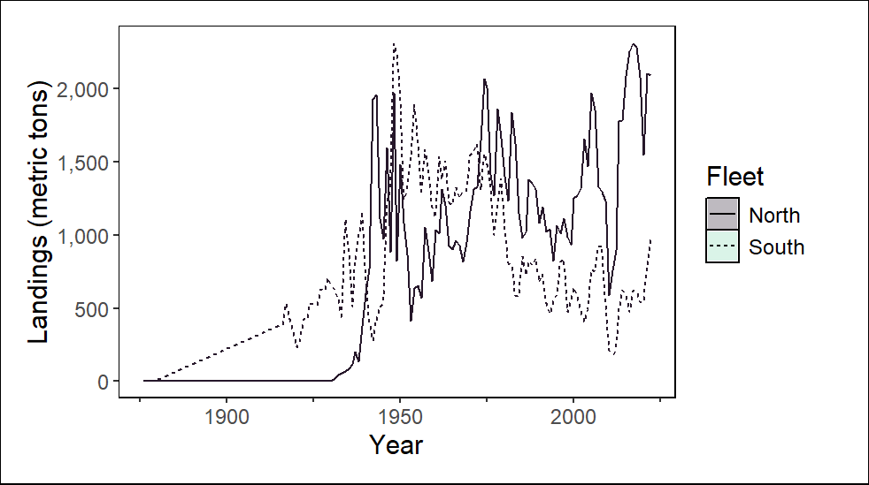

As requested, we have created an R script conveying the overall workflow to build a tagged {asar} report, with figures and tables from {stockplotr}.

```{r eval = FALSE}
# Day 0: Complete pre-workshop checklist: https://nmfs-ost.github.io/workflows-workshop/resources/checklist.html

# Day 2
## Set up basic report structure
library(asar)
create_template(
  format = "pdf", # optional "html"
  type = "sar", # add'l options: "safe", "nemt", "pfmc"
  office = "NWFSC",
  region = "U.S. West Coast",
  species = "Petrale sole",
  spp_latin = "Eopsetta jordani",
  authors = c("Samantha Bredeck" = "NWFSC", "Jane Doe"="PIFSC"),
  file_dir = getwd(), # folder where the "report" folder will be saved
  bib_file = TRUE # optional
)

## Insert additional text into the executive summary to highlight parameters, section tags, and references
exec_sum_path <- file.path(getwd(), "report", "01_executive_summary.qmd")
lines <- readLines(exec_sum_path, warn = FALSE)
writeLines(append(lines, "The stock assessment for `r params$species` was conducted by the `r params$office` in `r params$region`. The terminal spawning biomass for the current assessment year (`r end_year`) was `r SBend`. You can find more information on the results of this assessment in @sec-assmt-results. The guidelines for this report follow those outlined in @fishres:Waluda:2008:RSS.\n", after = 2), exec_sum_path)

## Convert model results
load(here::here("example_output", "petrale_r4ss.rda"))
library(stockplotr)
petrale <- convert_output(
  petrale_r4ss,
  save_dir = file.path(getwd(), "report", "petrale_conout.rda")
)

rerender_skeleton(
  file_dir = file.path(getwd(), "report"),
  custom_params = c("fleet_a" = "a long fleet name", "fleet_b" = "b long fleet name"),
  model_results = file.path("petrale_conout.rda"), # add the path to your model results file *in relation to your report skeleton*
  authors = c("Michelle Sculley"="PIFSC")
)

# Day 3
## Note: this script is written for setups using Quarto v1.9+, meaning that alt text is added without asar::add_alttext() and WITH the new native Quarto functionality
library(stockplotr)
plot_spawning_biomass(
  dat = petrale,
  ref_line = c("target" = 10),
  unit_label = "mt",
  module = "derived_quants",
  make_rda = TRUE,
  figures_dir = getwd() # indicate where to create a "figures" folder with the spawning biomass figure rda
)

table_landings(
  dat = petrale,
  module = "catch",
  make_rda = TRUE, # new argument needed to export plot
  tables_dir = getwd() # indicate where to create a "tables" folder with the landings table rda
)

library(asar)
create_figures_doc(
  subdir = fs::path(getwd(), "report"), # indicates the new figures doc will be saved in your "report" folder, located in the working directory
  figures_dir = getwd() # indicates your "figures" folder is located in the working directory
)

create_tables_doc(
  subdir = fs::path(getwd(), "report"),
  tables_dir = getwd()
)

## add table and figure manually to figure/table docs
table_example <- paste0("```{r} 
#| label: 'tbl-direct_code_table1' # choose a label
#| echo: false # don't show the code- only the output (table)
#| tbl-cap: This is your table caption.

# Import your data
load(fs::path('petrale_conout.rda'))
petrale <- out_new

# Make your table
your_table <- head(petrale) |>
  dplyr::select(label, year, estimate) |>
  gt::gt()

# Show your table
your_table
```\n\n", "")

table_qmd <- readLines(fs::path("report", "09_tables.qmd"))
table_qmd_new <- append(table_qmd, table_example)

writeLines(
  table_qmd_new,
  fs::path("report", "09_tables.qmd")
)


figure_example <- paste0("```{r} 
#| label: 'fig-direct_code_figure1' # choose a label
#| echo: false # show only the output, not the code
#| fig-cap: This is your figure caption.
#| fig-alt: This is your figure alternative text.

# Import your data
load(fs::path('petrale_conout.rda'))

petrale2 <- out_new |>
                    dplyr::filter(module_name == 'timeseries') |>
                    dplyr::filter(label == 'fishing_mortality') 

# Make your figure
your_figure <- ggplot2::ggplot(petrale2,
  ggplot2::aes(x = year, y = estimate, color = fleet)) +
  ggplot2::geom_line(linewidth = 0.75) +
  stockplotr::theme_noaa()

# Show your figure
your_figure
```\n\n", "")

figure_image <- "{fig-alt=\"This is the alternative text for my figure\" #fig-markdown_figure1}"

figure_qmd <- readLines(fs::path("report", "08_figures.qmd"))
figure_qmd_new <- append(figure_qmd, figure_example)
figure_qmd_new <- append(figure_qmd_new, figure_image)

writeLines(
  figure_qmd_new,
  fs::path("report", "08_figures.qmd")
)

## demonstrate how to reference figures in the report
figure_ref <- "I am referencing the example figure: @fig-direct_code_figure1."

intro_qmd <- readLines(fs::path("report", "02_introduction.qmd"))
intro_qmd_new <- append(intro_qmd, figure_ref)

writeLines(
  intro_qmd_new,
  fs::path("report", "02_introduction.qmd")
)

## render report into PDF
quarto::quarto_render(
  file.path("report",
            "sar_USWC_Petrale_sole_skeleton.qmd") # add your skeleton filename
)

## add tags to report to prepare for Section 508 compliance (accessibility requirements)
add_tagging(
  x = "sar_USWC_Petrale_sole_skeleton.tex", # your .tex report file
  dir = "report", # the folder containing the .tex file
  rename = "Petrale_sole_tagged", # the name of the new, accessible PDF
  compile = TRUE # we'll compile the PDF
)

```
